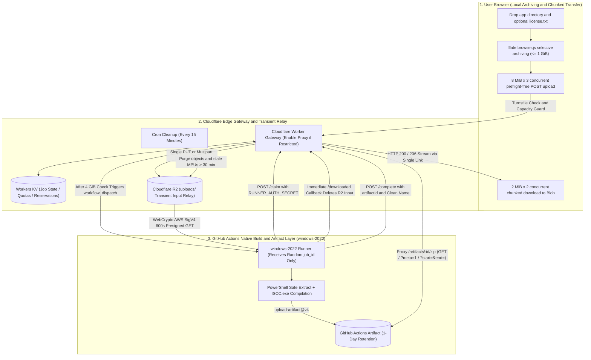

English | [简体中文](README.zh-CN.md)

# TuKuai-EXE

A cloud Windows x64 installer packaging system for **TuKuai Studio**: users drop a built desktop application folder in the browser, GitHub Actions compiles a standard `Setup.exe` installer on demand, and returns a single `.zip` download link natively via **GitHub Actions Artifacts**. **If direct access is not supported in your region, please enable a proxy (single native link, no regional mirrors).**

---

## Architecture & Data Flow



---

## End-to-End Flow & Core Technologies

| Stage | Data Flow (From -> To) | Core Technologies | What It Accomplishes |
| :--- | :--- | :--- | :--- |
| **1. Browser Packaging** | Local Folder -> In-Memory Browser Archive | `FileSystemDirectoryEntry` recursive traversal, bundled `fflate@0.8.2` ESM | Loops `readEntries` to bypass the 100-entry browser batch cap; stores already-compressed files (`.zip/.7z/.png/.asar`, etc.) via `ZipPassThrough`, lightly compresses `<= 64 MiB` compressible assets with `ZipDeflate (level: 1)`, and requires zero external CDNs |
| **2. Auth & Transient Upload** | Browser -> Worker -> R2 (`uploads/`) | Cloudflare Turnstile, Workers KV state machine, CORS-safelisted `text/plain` `POST`, R2 Multipart Upload, 4 GiB hard breaker | Validates Turnstile tokens and quotas (`5` req/hour/IP, `120` jobs/day global); enforces **actual R2 bytes + 6-minute reservations `<= 4 GiB`**; uploads `<= 8 MiB` in one request or slices `> 8 MiB` into `8 MiB x 3` concurrent chunks assembled by the Worker |
| **3. Dispatch & Burn-on-Read** | Worker -> GitHub Actions (`windows-2022`) | GitHub REST API (`workflow_dispatch`), WebCrypto `AWS SigV4` presigner, `/claim` + `/downloaded` isolation | Triggers public runners with only an opaque UUID `job_id` (no sensitive metadata in workflow logs); runner exchanges `RUNNER_AUTH_SECRET` at `/claim` for a 600-second SigV4 `GET` URL and invokes `/downloaded` right after download to delete the R2 source archive immediately |
| **4. Hardened Cloud Compile** | Runner Workspace -> Windows x64 Setup `.exe` | PowerShell safe unzip (Zip Slip & 3 GiB zip-bomb guard), encoding detection + **UTF-16 LE BOM + CRLF** transcoding, deterministic GUID, Inno Setup 6 (`ISCC.exe`) | Sanitizes `appName`/`appVersion`/`mainExe` against path traversal and INI injection; detects UTF-8/UTF-16/GB18030 `license.txt` and normalizes to UTF-16 LE BOM to prevent mojibake; derives a deterministic `AppId` and compiles `TuKuai-Setup-<slug>-x64.exe` with `lzma2/normal` |
| **5. Native Artifact Archiving** | Runner -> GitHub Actions Artifact | `actions/upload-artifact@v4` (`retention-days: 1`), `/complete` callback + workflow run fallback sync | Uploads the compiled `.exe` directly as a native GitHub Actions Artifact with no R2 artifact staging or cache; notifies `/complete` with `artifactId` and sanitized file name, backed by `/runs/{id}/artifacts` fallback sync |
| **6. Single-Link Proxy & Sweep** | GitHub Artifact -> Worker Proxy -> Browser `Blob` | GitHub `/artifacts/{id}/zip` 302 resolution, `?meta=1` probe, `?start=&end=` HTTP `206` forwarding, heartbeat retries, 15-min Cron | Exposes a **single "Download Installer (.zip)" button** (no regional mirrors): browser queries `?meta=1` for byte size, streams `2 MiB x 2` chunks (`25s` idle timeout, up to `5` retries with automatic single-stream step-down) while the Worker refreshes short-lived GitHub URLs and sets clean `Content-Disposition`; 15-min Cron deletes any stale R2 objects older than 30 min |

---

## Directory Structure

```text
TuKuai-EXE/
├── .github/workflows/build-installer.yml   # GitHub Actions workflow (claim, purge R2 input, compile, upload native artifact, complete callback)
├── scripts/build-installer.ps1             # Hardened unzip (Zip Slip / 3 GiB bomb guard), UTF-16 BOM transcoding, .iss generation, and ISCC build
├── web/
│   ├── TuKuaiEXE.html                      # Standalone UI (directory reader, fflate packager, chunked upload, single GitHub native download + proxy notice)
│   ├── fflate.browser.js                   # Locally vendored fflate@0.8.2 ESM module
│   └── index.html                          # Redirect to TuKuaiEXE.html
└── worker/
    ├── wrangler.toml                       # Worker static assets, KV/R2 bindings, quota limits, and 15-minute Cron trigger
    ├── test/core.test.mjs                  # Unit tests for metadata validation, Byte Range parsing, AWS SigV4 signing, and 30-minute TTL
    └── src/
        ├── index.ts                        # Edge HTTP gateway, 4 GiB breaker, GitHub Artifact proxy, runner internal APIs, and Cron sweep
        ├── sigv4.ts                        # Zero-dependency WebCrypto AWS SigV4 presigned URL generator
        ├── validation.ts                   # Metadata/part validation, Byte Range parser, constant-time secret check, and expiration helper
        └── types.ts                        # TypeScript interfaces for job records and Worker environment bindings
```
