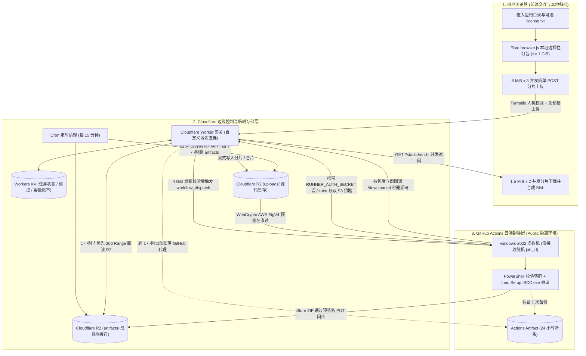

# TuKuai-EXE

面向 **TuKuai Studio** 的纯免费、零存储留存 Windows x64 安装包云端封装系统。用户无需配置任何服务器或本地编译环境，只需在浏览器中拖入已构建好的桌面应用目录，即可安全完成云端打包并高速下载标准 `Setup.exe` 安装包。

---

## 全链路架构与数据流转图



---

## 分阶段流程与核心技术栈

| 阶段 | 数据流向（从哪到哪） | 采用的核心专业技术 | 具体完成的工作 |
| :--- | :--- | :--- | :--- |
| **1. 浏览器打包** | 本地文件夹 → 浏览器内存归档包 | `FileSystemDirectoryEntry` 递归遍历、本地内置 `fflate@0.8.2` ESM | 兼容多级目录完整读取（循环读取规避浏览器 100 条截断），对 `.zip/.7z/.png/.asar` 等不可再压缩格式走 `ZipPassThrough` 零重压直存，其余文件走 `ZipDeflate (level: 1)` 轻量压缩，不依赖海外 CDN |
| **2. 鉴权与分片上传** | 浏览器 → Cloudflare Worker → R2 (`uploads/`) | Cloudflare Turnstile、Workers KV 状态机、CORS 简单请求、`text/plain` POST、R2 Multipart Upload、容量硬熔断 | 验证人机校验令牌与限流额度（单 IP 5 次/小时、全站 120 次/天）；按 **R2 实时已用 + 5 分钟预约占用 ≤ 4 GiB** 执行容量闸门防护；小于等于 `8 MiB` 单片上传，大于 `8 MiB` 切片并发（`8 MiB × 3`、自动重试 3 次）经自定义域名由 Worker 流式写入 R2 |
| **3. 调度与安全隔离** | Worker → GitHub Actions (`windows-2022`) | GitHub REST API (`workflow_dispatch`)、WebCrypto 原生 AWS SigV4 预签名、Claim 隔离架构 | 仅传入无意义的随机 UUID `job_id` 启动虚拟机（公开运行日志零敏感信息暴露）；Runner 持密钥调 `/claim` 领取 10 分钟有效源码读链接与 30 分钟有效成品回传链接，下载输入包后立即回调 `/downloaded` 秒删 R2 中的源码文件 |
| **4. 云端安全编译** | Runner 内存 → Windows x64 安装包 | PowerShell 安全解压（防 Zip Slip 路径穿越）、编码探测转码、防 INI 注入、Inno Setup 6 (`ISCC.exe`) | 严检 `mainExe` 合法性；自动识别 ANSI/GB18030/UTF-8 编码的 `license.txt` 并统一规范为 **UTF-16 LE BOM + CRLF**（消除英文构建机中文乱码）；按应用名派生确定性 GUID `AppId`；生成 `x64compatible` 安装脚本并调用 `ISCC.exe` 以 `lzma2/normal` 高压缩编译安装包 |
| **5. 成品回传与热缓存** | Runner → R2 (`artifacts/`) & Actions Artifact | `.NET ZipFile`（`CompressionLevel.NoCompression`）、S3 V4 Presigned `PUT`、Actions Artifact 冷备 | 将编译产物以纯存储模式封装进 `.zip`（避免浏览器拦截未签名 `.exe` 且无额外压缩耗时），直接走海外高速内网传回 Cloudflare R2 暂存 **1 小时**，同时上传 1 份保留 **1 天**的 GitHub Actions Artifact 作为冷备，最后回调 `/complete` 校验入库 |
| **6. 分片下载与焚毁** | R2 / GitHub → Worker → 浏览器合成保存 | Query `?start=&end=` 零预检分片、HTTP `206 Partial Content`、`ReadableStream` + `Blob` 合并、心跳超时与单路降级、Cron 定时巡检 | 前端先查 `?meta=1` 获取字节长度，随后按 **`1.5 MiB × 2` 并发 + `25 秒` 无数据流心跳超时（最多重试 `5` 次，连续抖动自动降为单路）** 拉取分片：1 小时内直读 R2 边缘节点（仅一次 `R2.get`），超 1 小时自动回落到 GitHub Artifact 分片转发；每 15 分钟 Cron 自动清除过期源码与超过 1 小时的 R2 成品缓存 |

---

## 目录结构

```text
TuKuai-EXE/
├── .github/workflows/build-installer.yml   # GitHub Actions 流水线（领包、秒删源码、编译、R2 回传与冷备）
├── scripts/build-installer.ps1             # 安全解压、UTF-16 BOM 转码、防注入 .iss 生成与 ISCC 编译脚本
├── web/
│   ├── TuKuaiEXE.html                      # 浏览器端核心页（目录读取、打包、分片并发上传/下载与主题联动）
│   ├── fflate.browser.js                   # 本地托管的 fflate@0.8.2 模块（免海外 CDN 访问）
│   └── index.html                          # 入口跳转页
└── worker/
    ├── wrangler.toml                       # Worker 路由、R2/KV 绑定、额度阈值与 15 分钟 Cron 配置
    ├── test/core.test.mjs                  # 核心校验、Range 解析、SigV4 与双 TTL 过期单元测试
    └── src/
        ├── index.ts                        # HTTP 路由网关、4 GiB 熔断、分片代理、Runner 内部接口与清理任务
        ├── sigv4.ts                        # 零依赖 WebCrypto AWS SigV4 预签名 URL 生成器
        ├── validation.ts                   # 元数据/分片校验、Byte Range 解析与恒定时间密钥比对
        └── types.ts                        # 任务与环境变量 TypeScript 类型定义
```
