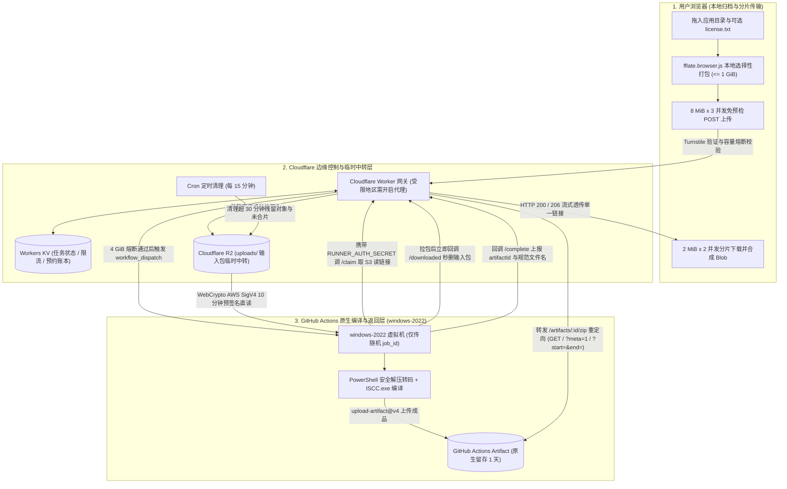

[English](README.md) | 简体中文

# TuKuai-EXE

面向 **TuKuai Studio** 的 Windows x64 安装包云端封装系统：用户在浏览器中拖入已构建好的桌面应用目录，由 GitHub Actions 在云端自动编译标准 `Setup.exe` 安装包，并通过 **GitHub Actions 原生 Artifact 通道** 返回单一 `.zip` 下载入口；**若您所在的地区不支持直接访问，请开启代理（仅提供单一原生入口，不设区域分流备用链接）**。

---

## 全链路架构与数据流转图



---

## 分阶段流程与核心技术栈

| 阶段 | 数据流向（从哪到哪） | 采用的核心专业技术 | 具体完成的工作 |
| :--- | :--- | :--- | :--- |
| **1. 浏览器打包** | 本地文件夹 → 浏览器内存归档包 | `FileSystemDirectoryEntry` 递归遍历、本地内置 `fflate@0.8.2` ESM | 循环调用 `readEntries` 规避浏览器单批 100 条目录截断；对 `.zip/.7z/.png/.asar` 等已压缩格式走 `ZipPassThrough` 直存，其余 `<= 64 MiB` 文件走 `ZipDeflate (level: 1)` 轻量压缩，不依赖外部 CDN |
| **2. 鉴权与临时上传** | 浏览器 → Worker → R2 (`uploads/`) | Cloudflare Turnstile、Workers KV 状态机、`text/plain` 简单请求 `POST`、R2 Multipart Upload、4 GiB 容量熔断 | 校验人机令牌与配额（每 IP 5 次/小时、全站 120 次/天）；检查 **R2 实际占用 + 6 分钟预约容量 `<= 4 GiB`**；`<= 8 MiB` 单片直传，大于 `8 MiB` 切片 `8 MiB x 3` 并发上传后经 Worker 合片 |
| **3. 调度与源码即焚** | Worker → GitHub Actions (`windows-2022`) | GitHub REST API (`workflow_dispatch`)、WebCrypto 原生 `AWS SigV4` 预签名、`/claim` 与 `/downloaded` 隔离机制 | 仅以随机 UUID `job_id` 触发构建（公开日志无敏感信息）；Runner 凭 `RUNNER_AUTH_SECRET` 向 `/claim` 领取 600 秒有效源码下载链接，拉取完成后立即回调 `/downloaded` 删除 R2 临时输入包 |
| **4. 云端安全编译** | Runner 工作目录 → Windows x64 安装包 | PowerShell 防 Zip Slip 解压、编码识别与 **UTF-16 LE BOM + CRLF** 转码、确定性 GUID、Inno Setup 6 (`ISCC.exe`) | 严检 `appName`/`appVersion`/`mainExe` 防注入与路径穿越；自动识别 UTF-8/UTF-16/GB18030 的 `license.txt` 并转码消除中文乱码；派生稳定 `AppId` 并调用 `ISCC.exe` 以 `lzma2/normal` 编译 `TuKuai-Setup-<slug>-x64.exe` |
| **5. 原生成品归档** | Runner → GitHub Actions Artifact | `actions/upload-artifact@v4`（`retention-days: 1`）、`/complete` 回调 + Run 状态兜底同步 | 将生成的 `.exe` 直接上传至 GitHub 原生 Artifact（不经过任何 R2 存储桶中转或缓存），携带 `artifactId` 与规范文件名回调 `/complete` 入库，若回调丢失则由 `/runs/{id}/artifacts` 自动兜底同步 |
| **6. 单一通道下载与巡检** | GitHub Artifact → Worker 代理 → 浏览器 `Blob` | GitHub `/artifacts/{id}/zip` 302 解析、Query `?meta=1` 探针与 `?start=&end=` Range 转发、心跳超时重连、15 分钟 Cron 清理 | 仅保留**单一“下载安装包 (.zip)”按钮**（无区域分流备用链接）：前端先查 `?meta=1` 获字节总长，再按 `2 MiB x 2` 并发（`25s` 心跳超时、最多重试 `5` 次、抖动时自动降为单路）请求 Worker 实时透传 GitHub 206 分片并附规范 `Content-Disposition`，拼装 `.zip` 保存；Cron 每 15 分钟清理 R2 超 30 分钟残留临时对象 |

---

## 目录结构

```text
TuKuai-EXE/
├── .github/workflows/build-installer.yml   # GitHub Actions 工作流（领包、秒删 R2 输入、编译、上传原生 Artifact 并回调完成）
├── scripts/build-installer.ps1             # 安全解压（防 Zip Slip / 3 GiB Zip 炸弹）、编码转码与 ISCC 编译脚本
├── web/
│   ├── TuKuaiEXE.html                      # 独立版前端页（本地归档、分片并发上传、单一 GitHub 原生下载入口与代理提示）
│   ├── fflate.browser.js                   # 本地内置 fflate@0.8.2 模块
│   └── index.html                          # 重定向至 TuKuaiEXE.html
└── worker/
    ├── wrangler.toml                       # Worker 静态资源托管、KV/R2 绑定、限流配额与 15 分钟 Cron 触发器配置
    ├── test/core.test.mjs                  # 元数据校验、Range 解析、SigV4 与 30 分钟 TTL 单元测试
    └── src/
        ├── index.ts                        # Edge HTTP 网关、容量熔断、GitHub Artifact 代理下载、Runner 内部接口与清理任务
        ├── sigv4.ts                        # 零依赖 WebCrypto AWS SigV4 预签名 URL 生成器
        ├── validation.ts                   # 元数据/分片校验、Byte Range 解析、常量时间比对与过期判断
        └── types.ts                        # 任务记录与 Worker 环境变量 TypeScript 类型定义
```

---

## 开源协议

Copyright © 2026 TuKuai。本项目采用 [Apache License 2.0](LICENSE) 开源协议。

> 第三方声明：`web/fflate.browser.js` 内置了 `fflate@0.8.2`（作者 Arjun Barrett），该库采用 MIT License。
